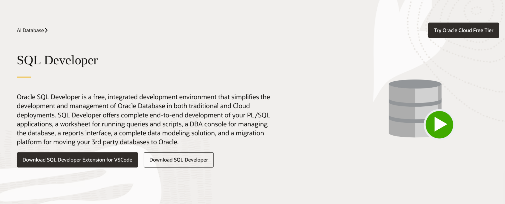
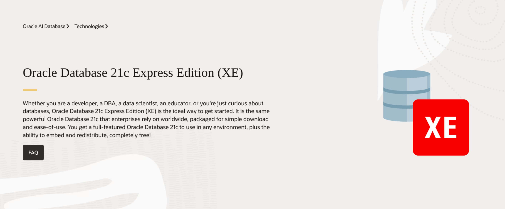

# rememberIt
Sistema integral de gestión de residentes, control de tratamientos medicamentosos y seguimiento de turnos para optimizar la administración en centros de cuidado.


## Django version 6.1.2

para que todos tenga la misma version de Django, instalen los requerimientos profavorsito.

``` sh
pip install -r requirements.txt
```

--- 
### Base de datos
1. Deben de tener instalado oracle SQL Developer -> https://www.oracle.com/database/sqldeveloper/


2. Deben de tener instalado Oracle Database 21c Express Edition (XE) -> https://www.oracle.com/database/technologies/xe-downloads.html


3. Deben de crear la base de datos mediante las migraciones de Django
    ``` sh
    python manage.py makemigrations

    python manage.py migrate
    ```

con esto se deberian crear todas las tablas en su DBMS